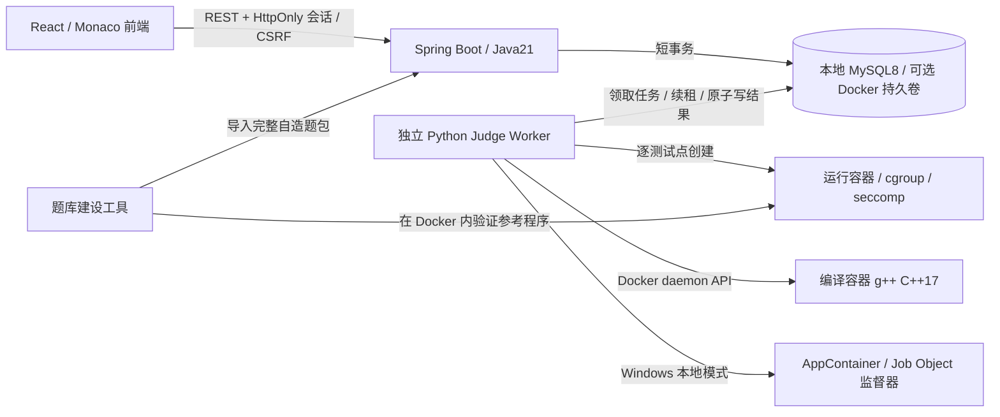

# Java 后端与判题架构

## 分层的责任

Controller 负责 HTTP 路由、参数校验和状态码，不处理编译运行。DTO 通过 Jakarta Validation 约束字段、列表和大小。Service 判断业务是否合法，并定义数据库事务边界。例如 `SubmissionService.submit` 从认证上下文获取 userId，锁住对应用户的任务准入，校验考试状态和题目建设状态，再持久化 QUEUED 任务。Repository 使用 JdbcTemplate 和参数化 SQL，集中处理数据库访问；不用 ORM 魔法，便于直接观察 SQL、索引、锁和事务。

数据库中正式提交保存 problemVersion 和 examId。编辑题目会生成公共题面快照，不修改已提交源代码；有活动任务或考试时禁止编辑，防止正在评测的数据发生变化。草稿使用 revision 作乐观版本检查。两个窗口同时保存同一版本时，只有第一个成功，第二个收到409。

## 为什么用持久任务队列

`POST /submissions` 只保存任务并返回202。耗时操作不在 Spring 请求线程执行，也不放在只存在内存的 `@Async` 队列中；否则进程重启会丢任务。任务表即可靠队列，个人场景先用 MySQL 可以避免增加 Redis 或消息中间件。

Worker 在短事务中使用 `SELECT ... FOR UPDATE SKIP LOCKED` 领取 QUEUED 或租约过期的 RUNNING 任务。多个 Worker 不会领到同一有效租约。每个领取尝试产生唯一 worker_id token，租约60秒，每10秒独立连接续租。编译/运行期间没有持有任务表行锁。

完成时再次锁任务并检查 token，旧尝试即使晚到也不能覆盖新尝试。所有测试点、子任务、最终状态与得分在一个事务内提交；因此查询不会见到部分写入的终态。基础设施异常重试最多3次后标为 SYSTEM_ERROR。Worker 崩溃后，另一实例在租约过期时接管，并清理旧尝试的沙箱。e2e 会实际杀死 Worker 验证恢复。

数据库锁控制任务状态，Docker 资源控制执行环境，二者职责清楚。后续若增加 RabbitMQ，可保留 submissions 作为状态与幂等记录，将领取机制替换为消息消费；不应为了个人首版提前增加基础设施。

## 沙箱执行链路

当前 Windows 本地版使用 `worker/windows_sandbox.py` 和 `sandbox/windows/runner.cpp`，不连接 Docker。编译与每个测试点都使用独立 AppContainer SID；专用工具链的公开文件只读，本次编译目录可写，运行目录和包私有目录只读。Job Object 先绑定挂起的进程，验证受限令牌后才开始执行；控制单 CPU、进程数量、已提交内存、CPU/墙钟时间与输出量。编译工作目录超过64MiB时终止，按编译失败报告。该目录限制通过轮询检测，可能有短暂超量，不能声称是文件系统硬配额。源码和可执行文件存在 Windows 判题临时目录，仍由 Windows 隔离机制执行，隔离失败没有普通进程回退。Windows 的内存统计不是 Linux RSS；两种部署的时限均是本站模拟限制。配置、数据位置和实际验证见 [Windows 部署](WINDOWS.md)。

以下是保留的 Linux / Docker 实现；不参与当前 Windows 启动流程。

可信 Worker 从 DB 读取源码与单个测试点。编译在临时容器内进行：g++ `-std=c++17 -O2 -pipe -DONLINE_JUDGE`，25秒编译墙钟上限、512MiB内存、1 CPU、32进程、有限文件大小。源码通过 Docker exec stdin 进入 tmpfs，产物从容器 stdout 读取；用户源码与产物从未在宿主机执行。避免依赖 Windows/WSL 路径映射。

每个测试点创建一个新运行容器，数据只包括二进制和输入；标准答案留在 Worker 中。根文件系统只读，无宿主 bind mount、无 docker.sock、无网络；/work 和 /tmp 为有界 tmpfs。CPU限制1核，cgroup硬内存限制、禁用swap、PID限制16。可信监督器以root运行，仅保留SETUID/SETGID/KILL以启动并终止不同用户的子进程；提交程序以65534运行，capabilities为空，no-new-privileges开启。

Docker默认seccomp始终保留，提交进程额外seccomp禁止clone/fork/socket/ptrace等调用。C++提交限单进程单线程。监督器与提交程序UID不同，用户程序不能改写监督器、伪造诊断协议或向其发信号。输出用非阻塞管道有界读取，同时限制stdout+stderr大小；时间到或输出超限终止进程组，最后强制删除整个容器。

TLE依据执行墙钟时间；MLE依据cgroup v2 memory.events的oom_kill增量或明确的容器OOM状态；不把所有退出137都猜作内存超限。RE提供返回码或信号值；CE提供截断的编译诊断。默认输出按字节token比较，忽略空白，保留内容差异。构造题可在样例和测试点配置预置的checkerType；例如202609第4题由可信Worker校验组数、成员覆盖和组内禁配关系，接受不同合法答案。判题器只有固定白名单，不执行管理界面上传的自定义判题脚本；未知类型拒绝评测。非UTF-8输出不会通过替换字符混淆比较。

容器内监督器、输入文件tmpfs和进程一起使用配置的cgroup内存预算；memoryKb为子进程ru_maxrss，受fork/exec前继承的监督器内存影响，不能当作与CCF完全相同的测量值。官方机器性能和原隐藏数据均不可重现，本站分数、时间和内存指标明确是模拟值。

## 评分和考试一致性

无子任务的测试点独立给分。有子任务的点只返回通过状态，整组全部AC才获得分数；允许两种模式混合，总配置恰好100。构造题还可以对同一输入设置组数与完整划分两个检查，202609第4题对应40%与60%，不会因为构造形式不同而误判。顶层状态取第一个失败测试点的类型，分数保留已完成的独立点或子任务部分分。

模拟考试固定4小时，截止时间在数据库；请求同时锁考试行，因此交卷与新提交有明确先后关系。截止前持久化的正式提交继续评测，每题最高分计入；截止后的新任务拒绝受理。每题problemVersion被固定，活动考试期间禁止修改题目。结束后的复盘仍能读取旧版本题面。倒计时由服务器时间校准，客户端时钟不会改变期限。

现在仅提供模考记录和成绩趋势。Spring Security 保护会话，AuthController 登录后轮换 sessionId；密码采用 BCrypt，写请求使用 CSRF token。数据库 auth_version 在改密时递增，请求过滤器拒绝旧版本会话。CurrentUser 从认证上下文提取 userId；草稿、提交和考试都使用参数化 user_id 条件。普通账户没有管理权限，默认管理员继承旧 user_id=1 的记录。

## 可靠性边界

Docker容器共享Linux内核，Worker的daemon socket有高权限，此部署只针对个人本机可信使用。没有将此实现宣传为抵御内核漏洞的公开多租户平台。扩展公开服务应使用专用判题宿主、gVisor/微虚拟机等更强隔离，且将API、数据库与Docker管理通道分开。

生成器和参考程序作为题包资产存入用户自己的数据库。普通API不提供隐藏输入和标准输出；管理导入不自动抓取第三方题目，也不在宿主机执行上传脚本。只有明确完成验证的数据进入FULL+VERIFIED，建设中的题只能查看合法题意或运行已有样例。

## 前端与接口约定

api/contracts.ts 描述真实 HTTP 字段，将 sourceBatch、startedAt 和 code/title 转成 UI 需要的标签。账号状态只保存在内存，刷新调用 /auth/me，密码和登录 Cookie 不进入 localStorage。

useDraft.ts 对每账户每题串行写入，成功保存后使用返回的 revision。自动保存、Ctrl+S 和切题共用这一写入路径，避免旧版本号导致误报409。sessionStorage 仅保留当前标签页尚未保存的代码；数据库草稿仍是长期保存的位置。跨窗口冲突由用户选择本地或服务端版本，空草稿也可正常恢复。

usePolling.ts 用请求代次阻止旧任务响应覆盖新任务。暂时网络故障只重试查询；不会重复 POST 提交。考试每2秒从服务器读取分数、状态及剩余时间，本地用单调时钟展示倒计时。题面读取考试记录中的 problemVersion，评分刷新不会重新初始化编辑器，交卷后未完成的判题仍继续更新成绩。
